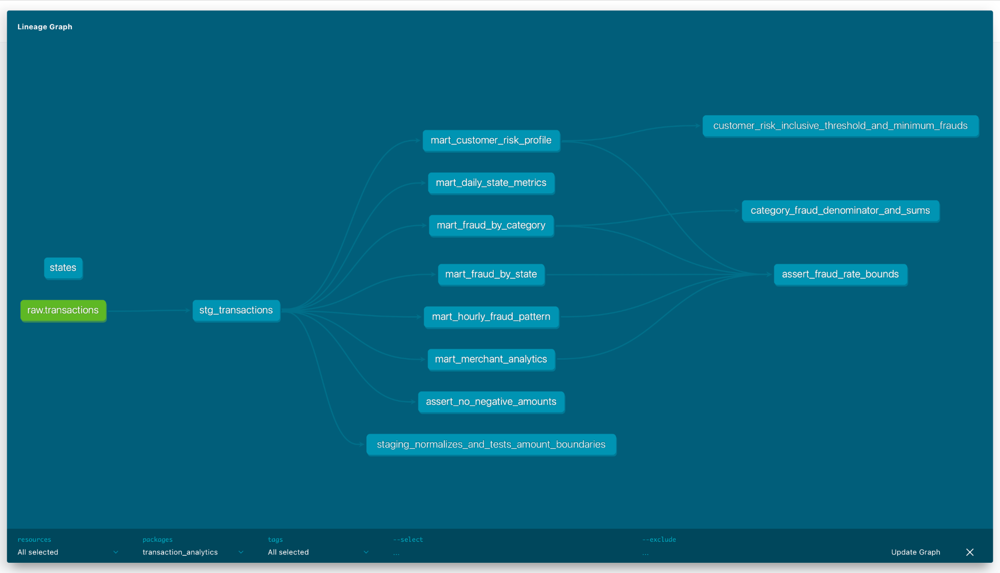

# Аналитика транзакций на dbt
Архитектура: homework.transactions -> stg_transactions -> marts
Используется только train.csv: 786431 транзакция. Фильтр задаётся переменной train_source_file в dbt_project.yml

## Запуск
- Требуются Python 3.12 и запущенный ClickHouse из домашней работы #2
- Таблица homework.transactions должна содержать загруженный train.csv

Из корня репозитория:

```bash
docker compose up -d
python3.12 -m venv dbt/.venv
source dbt/.venv/bin/activate
python -m pip install -r dbt/requirements.txt
cd dbt
make all
```

Если окружение с зависимостями уже настроено, достаточно выполнить make all
из каталога dbt/ в активированном окружении.
Команда устанавливает пакеты dbt, загружает seed, строит модели, запускает
тесты, SQLFluff и генерирует документацию.

Эквивалентные команды dbt из задания, из каталога dbt/:

```bash
export DBT_PROFILES_DIR="$PWD"
dbt deps && dbt seed && dbt run && dbt test
dbt docs generate
```

Документация:

```bash
make serve
```

Открыть <http://localhost:8080>. Граф зависимостей доступен через View Lineage Graph

## Подключение
profiles.yml настроен на 127.0.0.1:8123, пользователя и пароль homework
Исходная таблица homework.transactions, база витрин analytics
Подключение переопределяется переменными CLICKHOUSE_HOST, CLICKHOUSE_HTTP_PORT, CLICKHOUSE_USER, CLICKHOUSE_PASSWORD CLICKHOUSE_DATABASE и CLICKHOUSE_SECURE (True или False).
Исходная база и имя обучающего файла задаются в vars файла dbt_project.yml

## Витрины
| Модель | Назначение |
| --- | --- |
| mart_daily_state_metrics | Дневные метрики по штатам: число операций, оборот, средний чек, P95, доля крупных транзакций |
| mart_fraud_by_category | Количество фродов, fraud_rate и суммы по категориям |
| mart_fraud_by_state | Фрод по штатам, уникальные клиенты и мерчанты, суммы |
| mart_customer_risk_profile | История операций клиента, средний чек и риск HIGH/MEDIUM/LOW |
| mart_hourly_fraud_pattern | Паттерны по дням недели и часам, относительный риск временных окон |
| mart_merchant_analytics | Оборот, fraud_rate и флаг подозрительности мерчанта |

- Суммы хранятся в Decimal, fraud_rate выражен в процентах
- Пороги сегментации сумм и риска настраиваются через vars
- Ключ клиента построен по имени и адресу: идентификатора карты в данных нет
- В справочник включены 50 штатов и округ Колумбия (DC)

## Версии и проверки
- dbt-core 1.10.15, dbt-clickhouse 1.9.7, SQLFluff 4.4.0
- Пакеты: dbt_utils 1.3.0, dbt_date 0.10.1, dbt_expectations 0.10.4
- Макрос amount_bucket используется в staging для сегментации сумм
- Тесты: not_null, unique, accepted_values, связь со справочником штатов,
  уникальность ключей витрин, два singular-теста и три unit-теста.
- SQLFluff настроен для ClickHouse и dbt; конфигурация pre-commit .pre-commit-config.yaml

Для установки pre-commit из корня репозитория:

```bash
pre-commit install --config dbt/.pre-commit-config.yaml
```

Проверено на macOS с ClickHouse из Docker Compose: 7 моделей построены, 38 data tests и 3 unit tests прошли
(`PASS=41, WARN=0, ERROR=0, SKIP=0), SQLFluff завершился без замечаний.
Документация сгенерирована и открыта через dbt docs serve.

[Лог dbt test](evidence/dbt-test.log)


